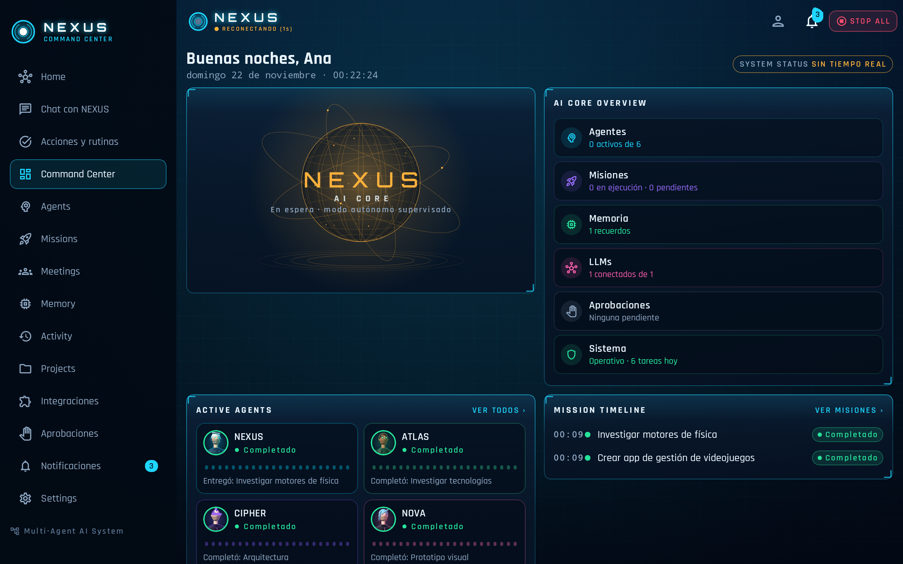
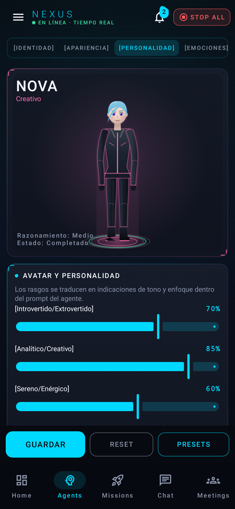
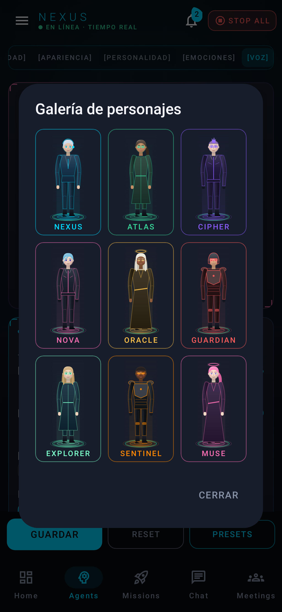

# NEXUS AI

Plataforma multiagente de inteligencia artificial: un equipo de agentes especializados que reciben
objetivos, los planifican como grafos de tareas, trabajan en paralelo en el servidor (aunque el
teléfono esté cerrado), se revisan entre ellos, conservan memoria y reportan al usuario. La app
Android es el centro de control.

| Dashboard (tablet) | Editor de personaje | Galería de personajes |
|---|---|---|
|  |  |  |

> Las capturas son renders reales de la app (Robolectric) contra respuestas reales exportadas del backend.

## Qué incluye

- **Backend** (`backend/`, Python 3.12 + FastAPI + PostgreSQL/pgvector + Redis):
  - Seis agentes iniciales (NEXUS, ATLAS, CIPHER, NOVA, ORACLE, GUARDIAN) y agentes personalizados, con
    identidad estable, instrucciones versionadas, permisos por herramienta y **personaje** (rasgos de
    personalidad y emocionales que modulan el prompt, apariencia y voz).
  - **Gateway multimodelo** con adaptadores para Anthropic, OpenAI, APIs compatibles con OpenAI, Google
    Gemini y Ollama; router por capacidades y calidad mínima, fallback solo a modelos compatibles, registro
    de tokens y costos, presupuestos diarios/mensuales/por misión/por agente y tope de tokens.
  - **Orquestador**: análisis y plan de NEXUS → DAG de tareas → ejecución paralela → revisión de ORACLE
    (con rondas de corrección) → auditoría de GUARDIAN → consolidación → informe → aprendizajes a memoria.
  - **Cola durable** en PostgreSQL con leases, reintentos, recuperación tras caídas e idempotencia de
    efectos (probado matando el worker en plena misión).
  - **Memoria** por ámbitos (agente, compartida, usuario, proyecto) con búsqueda híbrida (pgvector léxico +
    semántico + full-text), control de calidad (fuente, fecha, confianza, verificación, caducidad) e
    indexado de documentos (PDF, DOCX, TXT, Markdown, código).
  - **Reuniones** entre agentes con moderación, límites de rondas/tiempo/presupuesto y acta estructurada.
  - **Herramientas** con políticas de seguridad: memoria, web (búsqueda por plugin y lectura con protección
    SSRF), documentos y archivos versionados, borradores, sandbox Docker, recordatorios, notificaciones,
    webhook, consultas entre agentes, misiones y reuniones. Aprobaciones para lo sensible y **STOP ALL**.
  - Autenticación con JWT de corta duración y refresh tokens rotados con detección de reutilización,
    secretos cifrados (Fernet con rotación), rate limiting, auditoría, WebSocket autenticado, push FCM,
    métricas Prometheus, health/ready, exportación de datos.
- **App Android** (`android/`, Kotlin + Jetpack Compose): dashboard tipo command center, Agent Center con
  personajes de cuerpo completo, editor de personaje, chat con streaming y voz, Mission Center con vista de
  lista y de flujo, reuniones, memoria, actividad, proyectos, aprobaciones, notificaciones y ajustes
  completos. Sesión cifrada con Android Keystore, caché Room, reconexión automática, WorkManager y FCM.
- **Infraestructura** (`docker-compose.yml`, `infrastructure/`): desarrollo con Docker Compose, producción
  con HTTPS automático (Caddy), backups cifrados, Prometheus y CI en GitHub Actions.

## Inicio rápido

```bash
cd nexus-ai
./scripts/gen-secrets.sh > .env          # y revisá .env.example para el resto de opciones
docker compose up --build                # API en http://localhost:8000 (docs en /docs)
```

App: instalá `NEXUS-AI-debug.apk` (permite HTTP local) o la release (exige HTTPS), creá tu cuenta con la URL
del servidor y configurá un proveedor en **Ajustes › Proveedores de IA**. Sin proveedor configurado los
agentes no trabajan: la app lo muestra explícitamente en lugar de simular respuestas.

Guías: [instalación y despliegue](docs/setup/installation.md) · [proveedores y modelos](docs/setup/providers.md) ·
[arquitectura](docs/architecture/overview.md) · [decisiones](docs/architecture/decisions.md) ·
[API](docs/api/README.md) · [guía de uso](docs/user-guide/README.md) · [estado y reportes por fase](docs/PROGRESS.md)

## Pruebas

```bash
cd backend && .venv/bin/python -m pytest -q          # backend (PostgreSQL + pgvector requeridos)
cd android && ./gradlew :app:testDebugUnitTest         # lógica + UI de punta a punta con capturas
```
